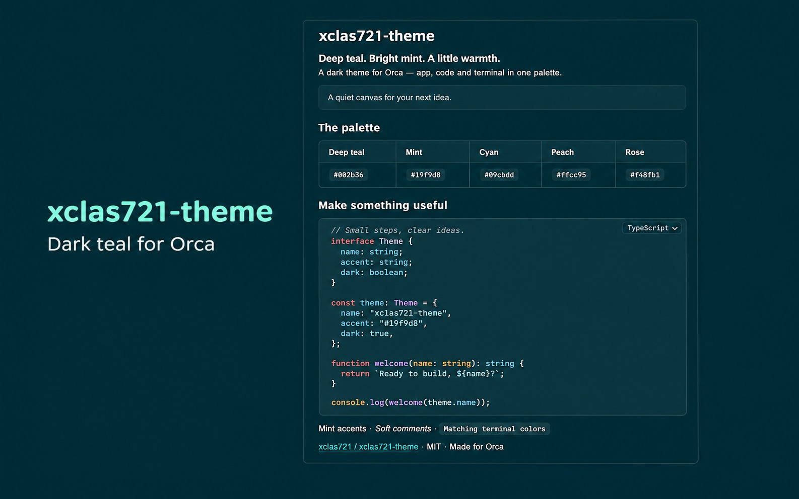

# xclas721-theme

A dark teal theme for [Orca](https://www.onorca.dev), with matching app, editor syntax and terminal colors.

Deep teal surfaces, mint accents, warm peach highlights and distinct blue and cyan terminal colors.
Requires **Orca 1.4.246 or later**. MIT licensed.



Cover composed from an Orca screenshot using AI-assisted cleanup and layout; private workspace
information has been removed. The layout is a presentation of the theme, not an unedited app capture.

## Install

Open the [Orca plugin directory page](https://www.onorca.dev/plugins/xclas721/xclas721-theme)
and choose **Open in Orca** once listed. If the page shows a listing status instead, the
community index has not listed the release yet.

In Orca, search for **xclas721-theme** under **Settings → Plugins** in the community catalog.
If your build does not include that catalog, follow the catalog setup instructions on the directory page.

After installing and enabling the plugin:

1. In **Settings → Appearance**, select **xclas721-theme** as the dark app theme.
2. In the terminal theme settings, select **xclas721-theme** for the matching ANSI palette.

For a direct Git installation:

```sh
orca plugin install xclas721/xclas721-theme
```

Or choose **Add plugin → From a Git URL…** and enter
`https://github.com/xclas721/xclas721-theme#v0.3.2` to install that specific release.

## Colors

The app, editor and sidebar share a `#002b36` background. Most separators use that same color
for a continuous surface. Cards and popovers use lighter teal, while inputs keep a visible
outline. Mint marks active tabs, focus rings and primary actions.

| Role | Color |
| --- | --- |
| App and editor background | `#002b36` |
| App foreground | `#e9f3f4` |
| Primary accent | `#19f9d8` |
| Comments | `#84979c`, italic |
| Declarations and imports | `#ff2c6d` |
| Control flow and parameters | `#f48fb1` |
| Strings | `#00acc1` |
| Functions and methods | `#09cbdd` |
| Types and classes | `#64ffdb` |
| Numbers and language constants | `#ff5622` |
| Operators and headings | `#ffcc95` |
| Terminal blue / cyan | `#5cb8f0` / `#09cbdd` |

The theme also defines chat surfaces, links, diff colors and Git file status colors.
Syntax colors depend on each language grammar's scopes; some grammars group several token
kinds together. Markdown preview and chat code blocks may use their own rendering and
highlighting, so they can differ from source editing.

## Preview and screenshots

Open [PREVIEW.md](PREVIEW.md) in Orca with this theme selected to prepare a cover screenshot.
It includes Markdown headings, emphasis, links, a palette and a short TypeScript example.
Use source view for Markdown syntax colors or preview view for a presentation of the theme.

Capture instructions, dimensions and manifest image fields are in [images/README.md](images/README.md).
The cover is included above; separate editor and terminal screenshots have not been captured yet.

## Repository layout

```text
orca-plugin.json    Plugin manifest and theme contributions
themes/dark.json   App tokens and editor syntax colors
terminal/dark.json Terminal ANSI palette
PREVIEW.md         Screenshot scene to open in Orca
images/            Screenshot instructions and future preview images
CHANGELOG.md       Release history
```

## Develop

```sh
orca plugin validate .
orca plugin dev watch .
```

The theme is plain JSON; no build step is required. The watch command loads the folder into
Orca and reloads changes on save. Ctrl-C unloads it. To install a local copy without watching:

```sh
orca plugin install .
```

## Release

1. Finish and validate the changes, including any image files and manifest references.
2. Set a new `version` in `orca-plugin.json` and move the matching changelog entries from
   **Unreleased** into a dated version section.
3. Commit the files, then run `orca plugin validate .` again.
4. Tag that commit `v<version>` and push the commit and tag. Never move an existing release tag.
5. Keep the repository public with the `orca-plugin` topic and check the
   [listing status](https://www.onorca.dev/plugins/xclas721/xclas721-theme).

The community directory discovers version tags automatically. A push to `main` alone does not
update the listed release. See the [official publishing guide](https://www.onorca.dev/plugins/add).

## Feedback

Report issues with your Orca version, operating system and a screenshot in
[GitHub Issues](https://github.com/xclas721/xclas721-theme/issues).

## License

[MIT](LICENSE). Copyright © 2026 xclas721.
